<p align="center">
  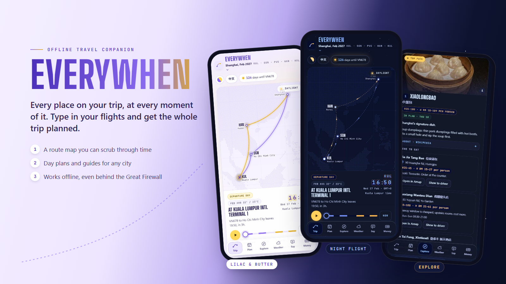
</p>

<p align="center">
  <b>Every place on your trip, at every moment of it.</b><br>
  Type in your flights. Everywhen plans the days, finds what to see and eat, and keeps working offline, even behind the Great Firewall.
</p>

<p align="center">
  <a href="https://chrystalfsc.github.io/everywhen/"><b>Open the app →</b></a>
  &nbsp;·&nbsp; <a href="#install-it-on-a-phone">Install on a phone</a>
  &nbsp;·&nbsp; <a href="#develop">Develop</a>
</p>

---

## A quick look

<table>
  <tr>
    <td align="center" width="25%">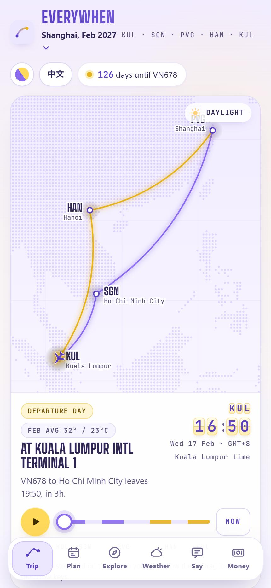<br><sub><b>Trip</b><br>Scrub through the trip; the plane, clocks and sky follow.</sub></td>
    <td align="center" width="25%">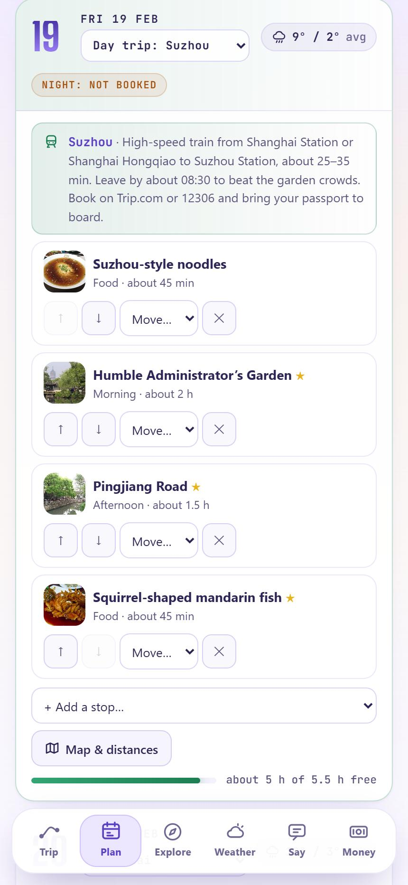<br><sub><b>Plan</b><br>Every day planned for you, then yours to change.</sub></td>
    <td align="center" width="25%">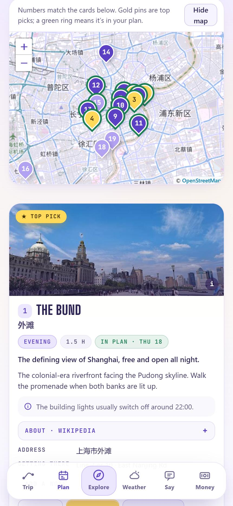<br><sub><b>Explore</b><br>Ranked places on a map, with photos and details.</sub></td>
    <td align="center" width="25%">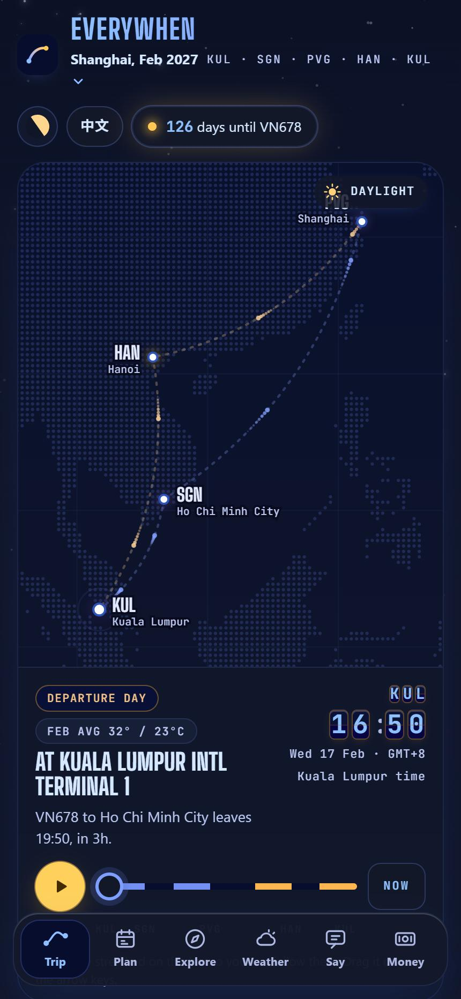<br><sub><b>Night Flight</b><br>One of six colour themes.</sub></td>
  </tr>
</table>

## From flights to a whole trip

You enter only your flights. Everything else is worked out from them.

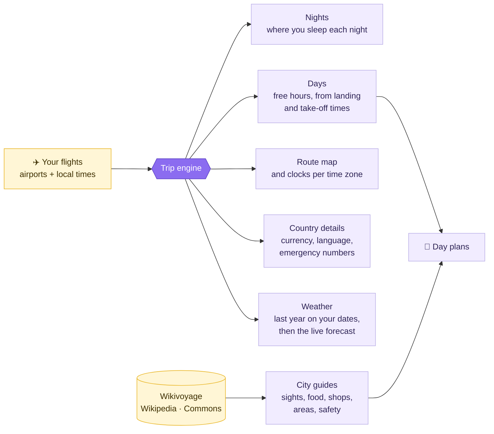

| Rule | How it works |
|---|---|
| **Stop or stay?** | Under 24 hours between flights is a transfer; longer is a stay. |
| **Where you sleep** | Each night goes to the city you're in at 23:30 local time, or is marked as an overnight flight. |
| **Free hours** | 08:00–22:00, starting 1.5 h after landing and ending 2.5 h before an international flight (1.5 h before a domestic one). |
| **Time zones** | Every time is stored as an instant and shown in each airport's own zone, so "be back by" times and time changes are calculated, not typed. |

<p align="center">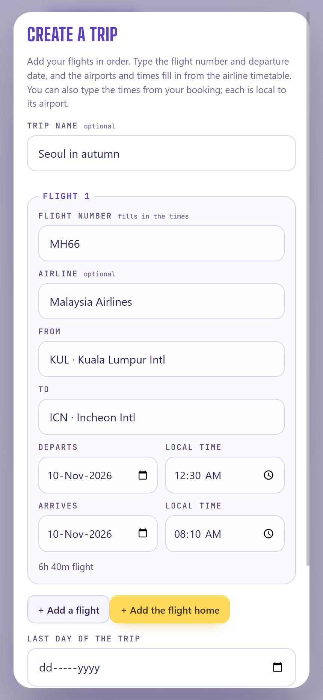</p>
<p align="center"><sub>Creating a trip: pick airports from all 7,917 with an IATA code. With a flight number and date, the times can fill in from the airline timetable.</sub></p>

## What's inside

| | Tab | What you get |
|---|---|---|
| 🗺️ | **Trip** | An animated route map with a time scrubber, local clocks, boarding-pass cards, layover "be back by" times, and every night of the trip with its hotel. |
| 📅 | **Plan** | Day-by-day plans built from your pace and interests, nearby stops grouped together, a map with walking and taxi times, rain warnings, and a pre-trip checklist. |
| 🧭 | **Explore** | Places, food, souvenirs, areas to stay and things to skip, ranked best first, with photos, opening hours, prices and a map. **Can I go to…?** checks any place against your trip. |
| ⛅ | **Weather** | Typical weather for your dates with a packing list, then a live 16-day forecast. |
| 💬 | **Say** | Type or speak to translate, a checked phrasebook, and a full-screen "take me to this address" card for drivers. |
| 💱 | **Money** | Converts prices the way they're written locally (`350k`, `1.5tr`), so 20,000 is never misread as 200,000. |

## Guides for any city

The example cities have hand-picked guides. Every other city gets one built the first time the app is online, in about 20 seconds, then saved for offline use.

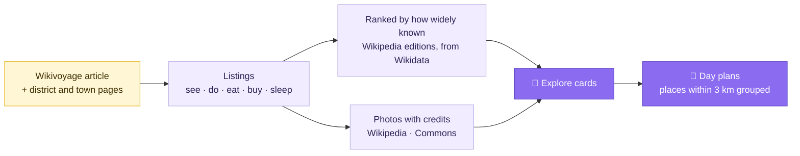

Photos are matched strictly: a file must name the place, and a restaurant's photo must also name the city or be geotagged within 2 km. When there's no reliable photo, a restaurant shows a labelled photo of the dish it's known for, and an activity shows one of the activity.

## Six colour themes

<table>
  <tr>
    <td width="34%">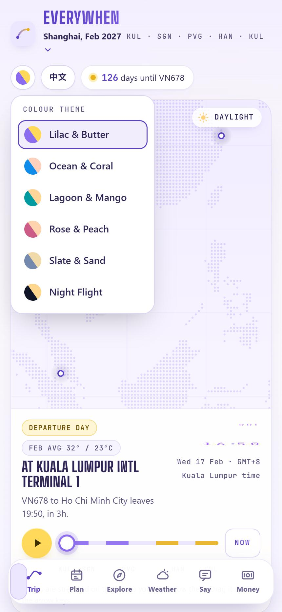</td>
    <td>

One button in the header switches the whole app, including the sky, maps and card covers.

| Theme | Mood |
|---|---|
| **Lilac & Butter** | Soft purple and pale yellow (default) |
| **Ocean & Coral** | Blue and coral |
| **Lagoon & Mango** | Teal and mango |
| **Rose & Peach** | Rose pink and peach |
| **Slate & Sand** | Calm grey-blue and sand |
| **Night Flight** | Deep navy, starlight, glowing gold routes |

Themes change only the *hue* of the colours, in OKLCH, so text keeps the same contrast in every one. Night Flight gives each colour a night version chosen by how it's used (text, surface or edge), and an automated scan of every text element on all six tabs finds nothing under 4.5:1.

</td>
<td width="30%">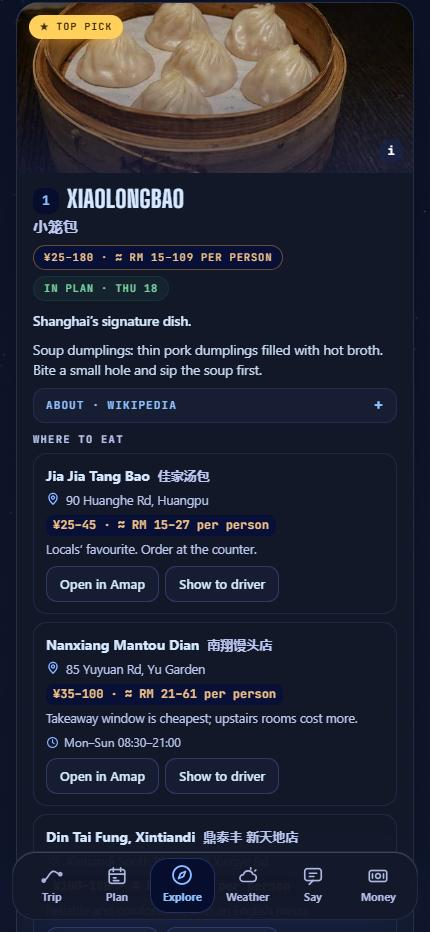</td>
  </tr>
</table>

Open the app with `?theme=night` (or `ocean`, `lagoon`, `rose`, `slate`) to choose a theme from a link.

## Works offline, and in China

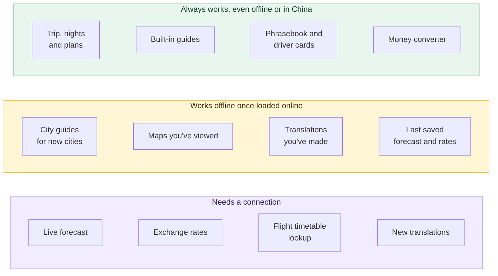

Wikipedia, Wikivoyage and Google are blocked in mainland China, so open your guides once before you fly. The app tells you when something couldn't load and what still works.

## Install it on a phone

| | iPhone (Safari) | Android (Chrome) |
|:-:|---|---|
| **1** | Open <https://chrystalfsc.github.io/everywhen/> | Open <https://chrystalfsc.github.io/everywhen/> |
| **2** | **Share → Add to Home Screen** | **⋮ → Install app** |
| **3** | Open it once from the home screen while online | Open it once while online |

After that it opens with no connection. New versions install themselves: the app reloads by itself if it has only just opened, or shows a **Reload** button if you're using it.

**Moving to another phone:** Plan tab → **Move to another device** gives a QR code, a link or a file. The data travels inside the link's `#fragment`, which browsers never send to a server.

## Develop

```bash
node scripts/build.js
```

```bash
python -m http.server 8765
```

Then open <http://localhost:8765>. The build inlines everything into one `index.html` (styles, scripts, fonts, map data and Leaflet) and versions the offline cache in `sw.js`.

```text
src/
  everywhen.html   markup and core logic        trip.js        trip model: stops, nights, days
  styles.css       the visual system            trips-ui.js    create / edit / switch trips
  theme.js         colour themes, tint()        autoguide.js   guides for any city
  engine.js        sky, flip board, motion      guide.js       planner and Explore
  map.js           Explore and day maps         evaluate.js    "Can I go to…?"
  mine.js          your own places              transfer.js    move to another device
  translate.js     translator                   i18n.js        English / 简体中文
data/      airports, land grid, guide coordinates, details, photos, Chinese strings, fonts, Leaflet
scripts/   build and data-gathering scripts
worker/    flight-lookup.js, a Cloudflare Worker that keeps the timetable API key secret
docs/      README images
```

<details>
<summary><b>Services it uses</b> (all optional; the app works without them)</summary>

| Feature | Service | Key needed |
|---|---|:-:|
| Weather | [Open-Meteo](https://open-meteo.com) forecast and archive | No |
| Exchange rates | [open.er-api.com](https://open.er-api.com) | No |
| Translation | [MyMemory](https://mymemory.translated.net) | No |
| Place search | [Photon](https://photon.komoot.io), [Nominatim](https://nominatim.openstreetmap.org) | No |
| Maps | [OpenStreetMap](https://www.openstreetmap.org/copyright) tiles, [Leaflet](https://leafletjs.com) 1.9.4 (bundled) | No |
| City guides and photos | [Wikivoyage](https://en.wikivoyage.org), [Wikidata](https://www.wikidata.org), Wikipedia, [Wikimedia Commons](https://commons.wikimedia.org) | No |
| Flight timetables | [AeroDataBox](https://rapidapi.com/aedbx-aedbx/api/aerodatabox) through `worker/flight-lookup.js` | Yes, kept in the Worker |

</details>

<details>
<summary><b>Language</b></summary>

Everywhen switches between **English** and **简体中文** instantly from the header, and starts in Chinese when the phone's language is Chinese. Dates, durations and prices are formatted for each language (2月19日周五, 2小时30分, 35万越南盾). Strings live in `data/zh.tsv`; `node scripts/i18n-check.js` lists anything untranslated.

</details>

<details>
<summary><b>Photos, rankings and credits</b></summary>

Built-in guide photos are lead images from Wikipedia articles, used only when freely licensed (CC0, CC BY, CC BY-SA or public domain); each card credits the author and licence. Rankings are editorial for the built-in guides and based on Wikipedia coverage for generated guides, never invented star ratings. Wikivoyage text is CC BY-SA and credited in the app. Fonts: Big Shoulders Display and JetBrains Mono (SIL Open Font License). Airport data: [mwgg/Airports](https://github.com/mwgg/Airports) (MIT). Map land data: Natural Earth via [world-atlas](https://github.com/topojson/world-atlas).

</details>

<sub>Entry rules, visa arrangements and app availability change. The checklist says so; confirm with official sources before you fly.</sub>
